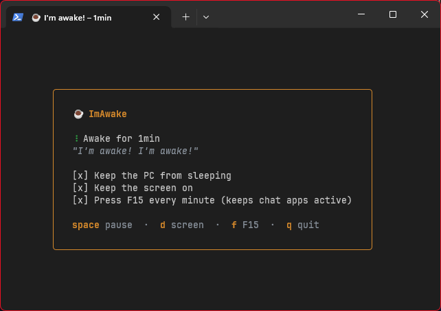

# ☕ ImAwake

**Keep your Windows PC awake — only while a small window is open.**

   

ImAwake is a tiny console app for Windows. Open it and your PC will not go to sleep. Close it and everything goes back to normal. No settings to change, no installer to trust, nothing left running in the background.



## Why

Long downloads, renders, backups and remote sessions die when Windows decides to sleep. The usual fixes are to change your power plan (and forget to change it back) or to install a tool that runs forever in the tray.

ImAwake takes a simpler approach: **the window is the switch.** While you can see it, your PC stays awake. When it is gone, so is the effect.

## Features

- **Window = switch.** Sleep is blocked only while ImAwake is open.
- **Safe by design.** It uses the official Windows API (`SetThreadExecutionState`). If the app crashes or is killed, Windows drops the request on its own. Your power settings are never touched.
- **Pause at any time.** Press `space` to let the PC sleep again without closing the window. The timer goes back to zero.
- **Screen on, if you want.** Press `d` to also keep the display from turning off.
- **Stay "Available" in chat apps.** Press `f` to have ImAwake press the unused F15 key every 59 seconds. Teams, Slack and similar apps then do not mark you as away. It is off when the app starts and stops while paused. Note: this counts as real activity for Windows, so the screen also stays on and the PC does not lock on its own, even with `d` off.
- **Live status.** A timer shows how long the PC has been awake, also in the window title, so you can see it in the taskbar. It counts in seconds during the first minute.
- **One at a time.** A second copy notices the first one and closes, so two windows never fight.
- **Terminal command.** `imawake`, `imawake window` and `imawake status` from any terminal.
- **No admin, no .exe.** Plain PowerShell scripts that ship with Windows. Nothing to compile, nothing unsigned to run.

## Requirements

- Windows 10 or 11
- Windows PowerShell 5.1 (built into Windows)
- [Windows Terminal](https://aka.ms/terminal) (built into Windows 11) for the full look; a plain console gets a simple ASCII version

## Install

1. Download or clone this repository.
2. Open PowerShell in the repository folder and run:

   ```powershell
   powershell -NoProfile -ExecutionPolicy Bypass -File scripts\install.ps1 -SourceDir src
   ```

The installer:

- copies the app to `%USERPROFILE%\Apps\ImAwake`
- creates an **ImAwake** shortcut on your desktop
- adds the `imawake` command to your user PATH (a backup of the old PATH goes to `%LOCALAPPDATA%\ImAwake\path-backup.txt`)

Open a new terminal window afterwards to use the `imawake` command.

From WSL, `scripts/install.sh` does the same in one step.

## Usage

Double-click the **ImAwake** shortcut, or use the terminal:

| Command | What it does |
| --- | --- |
| `imawake` | Run ImAwake in the current terminal |
| `imawake window` | Open ImAwake in a new Windows Terminal window |
| `imawake status` | Tell whether ImAwake is running, and since when |

Inside the window:

| Key | Action |
| --- | --- |
| `space` | Pause / resume |
| `d` | Keep the screen on (on / off) |
| `f` | Press F15 every 59 s to stay "Available" in chat apps (on / off) |
| `q`, `Esc` or `Ctrl+C` | Quit — the PC can sleep again |

## How it works

Windows lets an app say "I need the system to stay awake" through `SetThreadExecutionState`. ImAwake makes that call when it starts and releases it when it pauses or quits. Because the request belongs to the app's own thread, Windows ends it automatically when the process ends — even after a crash.

The code is split so the logic can be tested without Windows:

| Module | Role |
| --- | --- |
| `ImAwake.Core.psm1` | State, timer, texts — pure logic, no console and no clock reads |
| `ImAwake.Frame.psm1` | Draws the box as text lines — pure, no console |
| `ImAwake.Power.psm1` | The only place that calls Windows (power request, F15 key) |
| `ImAwake.Launch.psm1` | Helpers for the `imawake` command |
| `ImAwake.ps1` | The main loop: reads keys, draws the screen, applies the power state |

## Tests

122 [Pester](https://pester.dev) tests cover the logic, the drawing, the launcher, a real call to the Windows power API and a real F15 keypress.

```powershell
Import-Module Pester -RequiredVersion 3.4.0   # the version built into Windows
Invoke-Pester -Script tests
```

From WSL: `scripts/test.sh` (add `--coverage` for a coverage report).

## Uninstall

1. Delete `%USERPROFILE%\Apps\ImAwake` and the desktop shortcut.
2. Remove `...\Apps\ImAwake\bin` from your user PATH (Settings → System → About → Advanced system settings → Environment Variables).

## License

[MIT](LICENSE) © 2026 Wellington Fonseca. You may use, change and share the code, also commercially, as long as you keep the copyright notice.
